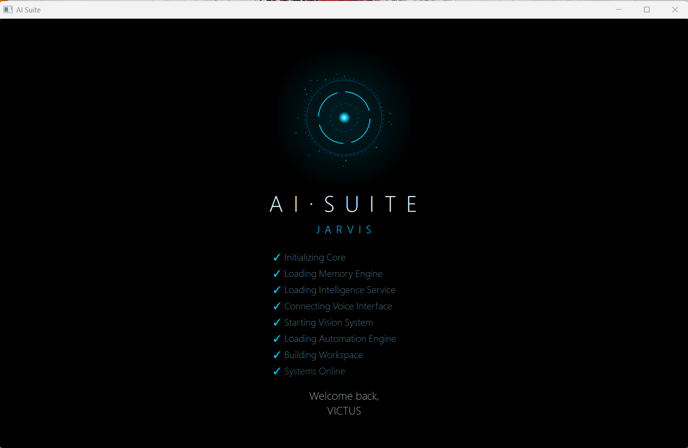
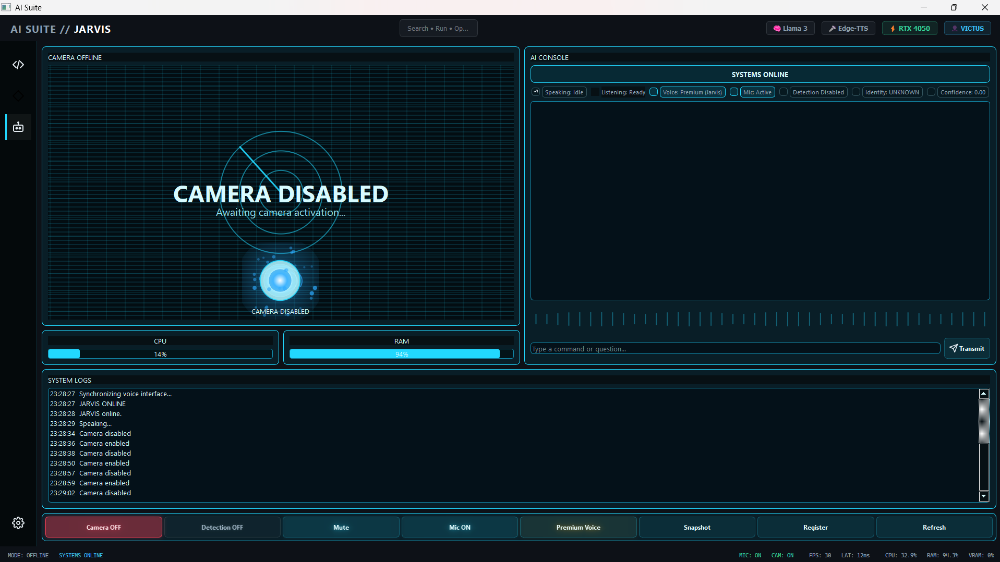
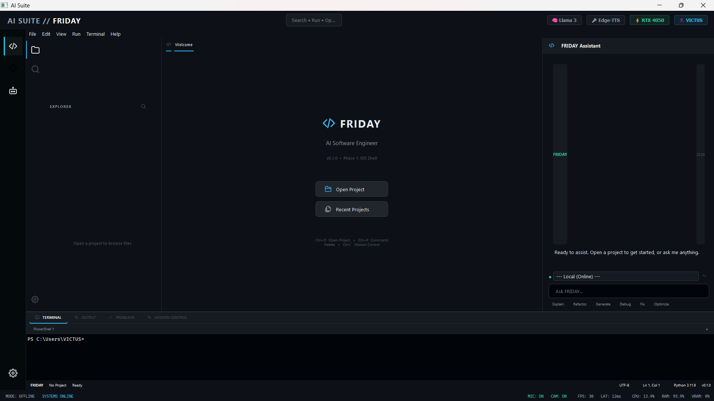
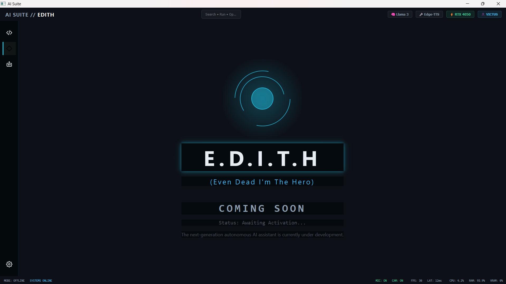

<div align="center">
  

  <h1>AI Suite</h1>
  
  <p><strong>The Autonomous AI Command Center</strong></p>

  <p>
    <a href="https://python.org"></a>
    <a href="https://github.com/your-org/jarvis/blob/main/LICENSE"></a>
    <a href="https://github.com/your-org/jarvis"></a>
    <a href="https://ollama.com"></a>
    <a href="https://github.com/your-org/jarvis/stargazers"></a>
  </p>
</div>

<br>

AI Suite is a next-generation local AI platform that seamlessly unifies JARVIS, FRIDAY IDE, and EDITH into a single intelligent desktop ecosystem for productivity, software development, automation, and AI-assisted workflows.

<br>

**🧠 JARVIS • 💻 FRIDAY IDE • 🤖 EDITH**

**Privacy First • Local AI • GPU Accelerated • Modular Architecture**

<br>

<h2 align="center">Boot Experience</h2>

<p align="center">
  
</p>

<br>

<h2 align="center">Workspaces</h2>

<p align="center">
  
  
  
</p>

<br>

## Features

### 🧠 JARVIS
- **Voice Assistant**: Ultra-low latency voice recognition paired with Edge-TTS for fluid conversational interactions.
- **Vision**: Deep integration with desktop events, capable of 'seeing' your screen using Computer Vision.
- **Object Detection**: Identifies objects and elements on-screen in real time.
- **Face Recognition**: Securely registers and recognizes authorized users.
- **Local LLM**: Fully powered by local Ollama models (e.g., Llama 3) ensuring zero telemetry.
- **Memory**: Contextual persistence across sessions and tasks.
- **System Automation**: Execute cross-platform terminal commands and Python macros dynamically.

### 💻 FRIDAY IDE
- **AI Code Assistant**: A full-fledged agentic coding assistant within your development environment.
- **Multi-file Workspace**: Work across your entire project rather than just a single file.
- **Intelligent Editing**: AI-driven refactoring and code generation.
- **Interactive Diff**: Review and apply changes natively before execution.
- **AI Actions**: Orchestrate autonomous coding, debugging, and continuous integration loops seamlessly.
- **Terminal Integration**: Full terminal environment linked directly to your active workspace.

### 🤖 EDITH
- **AI Visualization**: Real-time holographic rendering of internal AI states.
- **Holographic Dashboard**: A cinematic interface for monitoring system health and events.
- **Future Autonomous AI Framework**: Advanced security, packet monitoring, and threat analysis suite (Coming Soon).

### ⚙ AI Suite
- **Unified Workspace Switching**: Hot-swappable AI personalities tailored for specific cognitive tasks.
- **Modular Architecture**: Decouples the UI from the underlying intelligence framework.
- **Local-first Design**: Absolute privacy. Your code, screen, voice, and data never leave your machine.
- **GPU Acceleration**: Native PyTorch and ONNX support for massive performance improvements during local inference.
- **Shared Services**: Reusable registries and capabilities injected dynamically.
- **Event Bus**: Powerful inter-process and inter-widget event handling.
- **Workspace Manager**: Safely suspends and resumes environments instantly.

---

## Architecture

AI Suite relies on a powerful Event Bus to decouple the UI from the underlying intelligence framework.

```text
AI Suite
├── JARVIS
├── FRIDAY IDE
├── EDITH
├── Shared Services
├── Event Bus
├── Workspace Manager
├── Session Manager
└── Intelligence Layer
```

---

## Installation

Installing AI Suite is designed to be straightforward. Follow these steps to get your local AI environment running.

### Prerequisites

- **Python 3.11**: You **MUST** install Python 3.11. (Newer versions like 3.12+ may encounter compatibility issues with PyAudio).
- **Git**: Required to clone the repository.
- **Ollama**: Required for running local LLMs. Download from [ollama.com](https://ollama.com).
- **CUDA (Optional)**: If you have an NVIDIA GPU, install the appropriate CUDA toolkit for massive performance improvements.

### 1. Clone the Repository

```bash
git clone https://github.com/your-org/jarvis.git
cd jarvis
```

### 2. Create a Virtual Environment

<details>
<summary><b>Windows</b></summary>

```cmd
python -m venv .venv
.venv\Scripts\activate
```
</details>

<details>
<summary><b>Linux / macOS</b></summary>

```bash
python3.11 -m venv .venv
source .venv/bin/activate
```
</details>

### 3. Install Dependencies

```bash
pip install -r requirements.txt
```

### 4. Configuration

<details>
<summary><b>Windows</b></summary>

```cmd
copy .env.example .env
```
</details>

<details>
<summary><b>Linux / macOS</b></summary>

```bash
cp .env.example .env
```
</details>

*(Optional) OpenRouter Setup:*
If you wish to use cloud models specifically within the FRIDAY workspace, open `.env` and add your API key:
```ini
OPENROUTER_API_KEY=sk-or-v1-...
```

### 5. Start Ollama

Ensure Ollama is running in the background. Open a separate terminal and pull your preferred local model (we recommend `llama3` for general use):

```bash
ollama run llama3
```

### 6. Launch AI Suite

You are ready to launch the application:

```bash
python ai_suite/main.py
```
*(Alternatively, use `python launcher.py` to start a specific workspace from the command line).*

---

## First Startup Guide

When you launch AI Suite for the first time, you will experience the **Cinematic Boot Sequence**.

1. **Boot Overlay**: A full-screen glowing arc reactor interface will appear.
2. **Loading Process**: Background threads (the `BootWorker`) will safely initialize the Event Bus, Database, and Workspace Managers without freezing the UI.
3. **Workspace Loading**: The default workspace (JARVIS or FRIDAY) will be injected into the layout.
4. **First Interaction**: The boot screen will smoothly dissolve, revealing your dashboard. You can now use the text input field or voice controls (if enabled) to speak to your AI.

---

## Configuration

AI Suite offers extensive configuration to tailor the experience to your hardware. Most settings can be tweaked inside `.env` or via the `ai_suite/core/config/` directory.

- **TTS Configuration**: Adjust Edge-TTS voices and speech rate.
- **Model Selection**: Switch between local Ollama models and cloud OpenRouter models.
- **Hardware Acceleration**: Enable/disable PyTorch CUDA offloading.

---

## Project Structure

```text
jarvis/
├── ai_suite/                # Core Application Framework
│   ├── core/                # Event Bus, DI Container, Registry
│   ├── intelligence/        # Hardware integrations (GPU, Audio)
│   ├── managers/            # Session, Assistant, and Workspace Managers
│   ├── models/              # Provider Factories (Ollama, OpenRouter)
│   └── ui/                  # Qt User Interface (Boot System, Dashboard)
├── jarvis_ai/               # Personal Assistant Workspace
├── friday_ai/               # Developer IDE Workspace
├── docs/                    # Architecture and API Documentation
└── assets/                  # Icons, Stylesheets, and Media
```

---

## Roadmap

Our vision for AI Suite v1.1 and beyond:
- Complete Voice Mode 2.0 with Real-Time interruption.
- Launch the EDITH Security Workspace.
- Deep Visual context via multimodal local LLMs.
- Autonomous file-system manipulation agents.

---

## Known Issues

- **High Memory Usage**: Loading 7B+ parameter models locally requires at least 8GB of RAM/VRAM.
- **Audio Capture**: Certain Windows environments may require manually granting microphone permissions.

---

## Privacy

AI Suite is designed to be **Zero-Trust**. 
- The repository enforces strict `.gitignore` rules to ensure your local `data/` directories, SQLite databases, screenshots, and logs are never tracked.
- Runtime data never leaves your machine unless you explicitly configure an external API provider like OpenRouter.

---

## Security

If you discover a vulnerability, please do NOT open a public issue. Refer to [SECURITY.md](docs/SECURITY.md) for our coordinated disclosure guidelines.

---

## Contributing

We welcome contributions from the community! Whether it's a new Workspace, a UI enhancement, or a bug fix.

Please review our [Contributing Guidelines](docs/CONTRIBUTING.md) and our [Code of Conduct](docs/CODE_OF_CONDUCT.md) before submitting a Pull Request.

---

## License

This project is licensed under the **Apache License 2.0**. See the [LICENSE](LICENSE) file for details.

---

## Acknowledgements

- Built on top of [Ollama](https://ollama.com/) for local inference.
- UI powered by [PyQt5](https://riverbankcomputing.com/software/pyqt/).
- Speech recognition via [Vosk](https://alphacephei.com/vosk/).

---

<div align="center">
  <strong>If you found this project helpful, please consider leaving a ⭐ on the repository!</strong>
</div>
